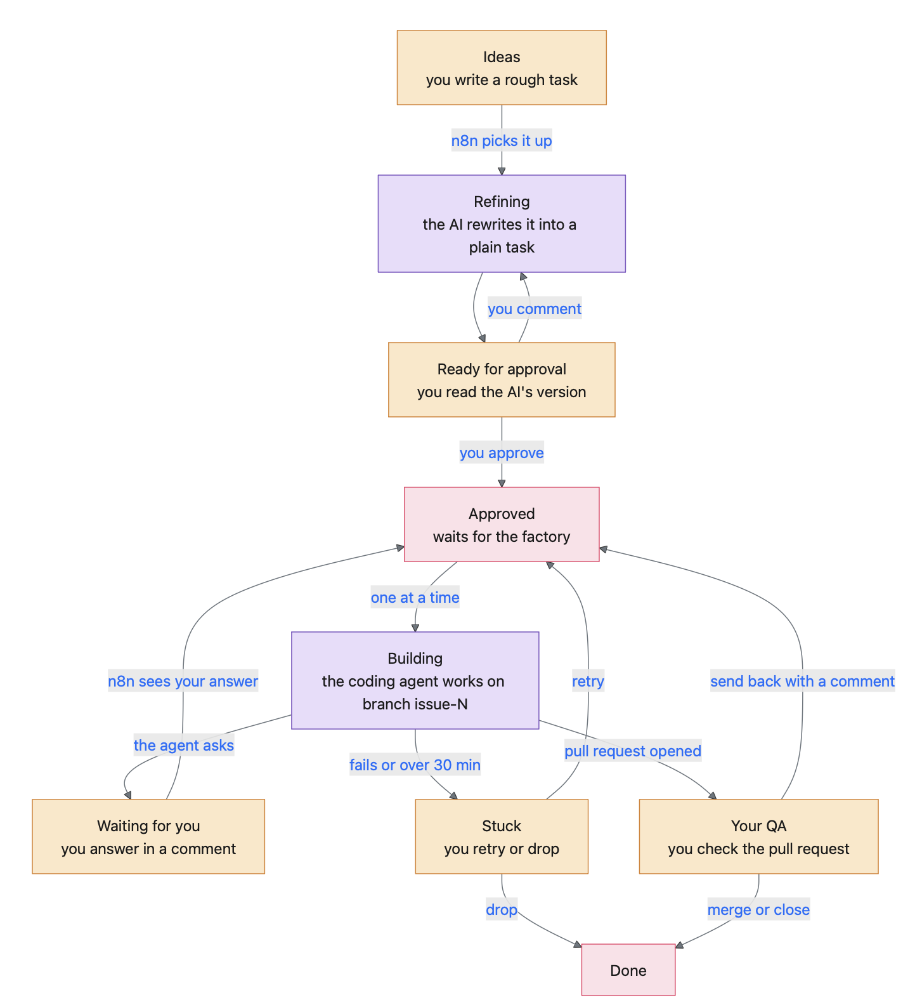
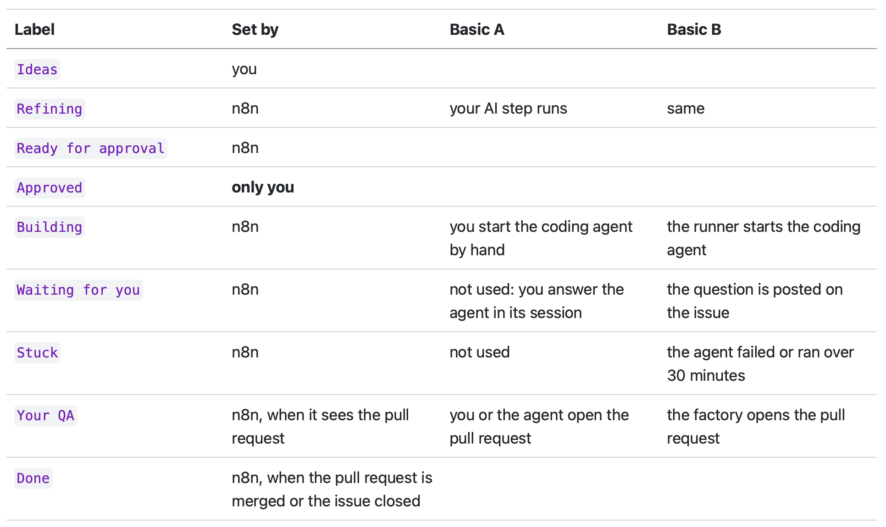
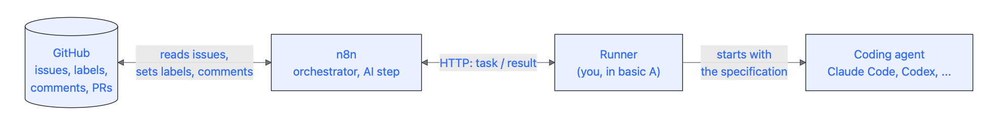

# Final project
In the final project you will design, build and evaluate your own small software factory: a system where you write a specification, a coding agent builds it, and you stay in control of what gets accepted.

The purpose of the project is to apply the concepts from the course in a realistic way of working. You are not expected to build a coding agent. You are expected to build the system around one: the workflow that picks up tasks, starts the agent, handles its questions and hands its work back to you for review.

The factory’s input is a task: a short specification of what to build. The project should result in a working factory. It should not just be a diagram or a demo of a single run. You must run real tasks through it and show what worked and what did not.

### Project type

This is an individual project. You can help each other, but you have to turn in your own project. Projects that are too similar may be a problem at the exam, so make your factory your own.

### Scope

You must build a prototype of a software factory that works on a code repository.

You use one repository. It holds the factory itself (your n8n workflows and your runner) and, in its own folder, something the factory builds for you, for example a small chess game. All tasks are issues in this repository, so n8n only has to watch one place.

It is recommended that you also build the factory with the factory. Start by building it with your coding agent in the usual way, for example Claude Code or Codex in VS Code. As parts of the factory start working, let the factory take over its own tasks, e.g. when you start extending or fixing the factory. Keep your n8n workflows as JSON files in the repository: the agent changes the JSON in a pull request, and you import it into n8n by hand after your review. That manual step is part of your quality check.

Use the coding agent you already have access to (for example Claude Code or Codex CLI). No particular provider is required. You may also run the coding agent on a local model through Ollama, but it might be hard to do.

## How the factory works

Each task is an issue, and its label is its state. This is how a task moves through the factory:

Orange: you act. Purple: the AI works. Pink: n8n moves the task on.

In words:

1. Ideas — you write a rough task as an issue with the label Ideas.
2. Refining — your AI step in n8n rewrites it into a plain task and asks you questions in a comment.
3. Ready for approval — you read the AI’s version. Comment to discuss it, and it goes back to Refining. When you are happy, you move it to Approved.
4. Approved — the task waits until the factory has room. One task is built at a time.
5. Building — the coding agent works on the task in its own branch, issue-N.
6. Waiting for you — the agent has a question instead of guessing. You answer in a comment. n8n sees your answer and moves the task back to Approved.
7. Stuck — the agent failed or ran for more than 30 minutes. Move the task to Approved to retry, or close it to drop it.
8. Your QA — the work is a pull request with a summary of what the agent did. You check it: merge it, close it, or send it back to Approved with a comment. Tests help here: ask the agent to write and run them. Otherwise, try the result yourself before you merge.
9. Done — the pull request is merged or the issue is closed.
#### Specification template
Your rough task in Ideas can be short. Your AI step rewrites it into a plain task that follows a fixed template, so the coding agent always gets the same information. For example: what to build, why, constraints, and acceptance criteria that can be checked. The template is part of your AI step’s prompt. You design it yourself and explain your choices in the report.

## States
The states are labels on the issue. Who sets each one:

Labels are the simple choice. A GitHub Project board with a Status field looks nicer, but n8n’s GitHub node cannot change it, so you would need GraphQL calls through an HTTP node.

## Basic and advanced

The project has two steps: basic and advanced. Basic has two parts, A and B. Build basic A first, then basic B. Advanced builds on basic.

### Basic A: manual factory
the task board is GitHub Issues or a similar issue tracker, with labels as the task states
an n8n workflow asks the task board for new tasks on a schedule and sets the state of each task
one AI step in n8n with a prompt you have written yourself: a refinement of the task. The AI rewrites the rough task into a plain task, asks you questions, and moves it from Refining to Ready for approval. It gives advice as a comment. You still decide. It can run on a local Ollama model
you start the coding agent by hand, with the issue as its input. It works in its own branch
the agent asks instead of guessing. You answer its questions yourself, in the agent’s session
the result is a pull request with a summary, and test results if the agent wrote tests
nothing is merged into main without your review
### Basic B: automated factory
the factory marks an Approved task as Building and starts the coding agent itself, through a runner: a small program or container that runs the agent without you. You build the runner yourself, from the architecture below
one task at a time, and only tasks written by you
the agent’s questions are posted on the issue, and the task moves to Waiting for you. When you answer in a comment, n8n moves the task back to Approved, and the agent starts again with your answer
the factory opens the pull request
a task moves to Stuck if the agent fails or runs for more than 30 minutes

#### Advanced: safe and extended
The advanced part comes later. It makes the factory safer and extends it, for example with a memory of past tasks in Neo4j and an MCP server.

## Architecture

The factory has four parts:

GitHub (or a similar service) holds everything the factory knows. An issue is a specification, its label is the state, the comments are questions and answers, and the pull request is the result.
n8n is the orchestrator. It asks GitHub for changes on a schedule, runs your AI step, changes labels, writes comments and opens pull requests.
The runner (basic B) is a small program, for example in Python, that n8n calls over HTTP. It does only what n8n cannot do: it checks out the repository on a new branch, starts the coding agent with the specification as its prompt, pushes the branch, and reports back: done, question or stuck. It stops the agent after 30 minutes. A run can take many minutes, so the runner answers n8n at once and works in the background, and n8n asks for finished results on a schedule. In basic A you do this part yourself.
The coding agent does the work. Tell it to end every run by stating whether it is done, has a question or is stuck.

### n8n workflows
Basic A has three n8n workflows: refine the task (Ideas to Ready for approval; it also watches for your comments and moves the task back to Refining, or, in basic B, from Waiting for you to Approved), start a task (Approved to Building), and track pull requests (Your QA and Done). Basic B adds one more: collect the results from the runner. Name your branches after the issue, for example issue-12, so a workflow can link a pull request to its task.

Two practical points. Let n8n ask GitHub for changes on a schedule: GitHub cannot call n8n on your laptop. And when n8n runs in Docker, it reaches a program on your own machine at host.docker.internal, not localhost.

## Suggested process

You should work through the project in roughly this order:

- Create your repository and the labels for the task states.
- Design the factory: states, workflow, your AI step and permissions.
- Build basic A with your coding agent. Tip: let the coding agent build and test your n8n workflows through an n8n MCP server (see week 8).
- Run your first tasks through the factory. If you build the factory with the factory, the next parts of the factory are good first tasks.
- Automate: build the runner and let n8n start the agent (basic B).
- Make the factory safer and extend it (advanced).
- Run tasks that are not about the factory, for example a small chess game.
- Evaluate the factory: where it worked, where it stopped, and where you had to step in.
Document the project.